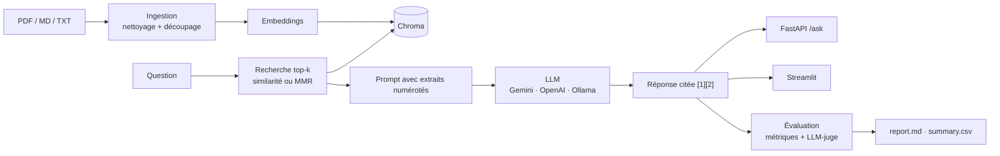

# Assistant RAG documentaire — avec protocole d'évaluation

Un assistant qui répond à des questions sur un corpus de documents (PDF, Markdown, texte) **en citant ses sources**,
et surtout un **banc d'évaluation reproductible** pour comparer objectivement des configurations :
découpage, recherche, modèles d'embeddings, LLM propriétaires vs open source — en qualité, latence et coût.


## Architecture



| Module | Rôle |
|---|---|
| `ragassist/ingest.py` | lecture PDF page par page, nettoyage, découpage, indexation Chroma (index réutilisé tant que corpus/embeddings/découpage ne changent pas) |
| `ragassist/pipeline.py` | recherche, prompt avec règles de citation et de refus, mesure latence / tokens / coût |
| `ragassist/llm.py` | fabrique de modèles : Gemini, OpenAI, Ollama, + modèles hors-ligne pour les tests |
| `ragassist/metrics.py` | métriques déterministes : hit@k, MRR, rappel des preuves, citations, refus |
| `ragassist/judge.py` | LLM-juge : fidélité aux extraits et exactitude vs référence |
| `ragassist/evaluate.py` | lance toutes les configurations, produit le rapport comparatif |
| `ragassist/generate_questions.py` | brouillon de questions synthétiques à relire |
| `ragassist/api.py`, `app/streamlit_app.py` | API REST et démo (chat avec sources + tableau de bord des évaluations) |

## Démarrage rapide (sans clé d'API)

```bash
python -m venv .venv && source .venv/bin/activate
pip install -e ".[ui,dev]"
pytest                                             # 13 tests hors-ligne
python -m ragassist.evaluate --experiments configs/experiments-offline.yaml --questions examples/questions.jsonl
RAG_CONFIG=configs/demo-offline.yaml streamlit run app/streamlit_app.py
```
La configuration hors-ligne utilise un LLM factice : elle sert à vérifier l'installation, pas à juger la qualité.

## Avec un vrai corpus

```bash
cp .env.example .env                               # GOOGLE_API_KEY, OPENAI_API_KEY…
# 1. dépose tes documents dans data/raw/
python -m ragassist.ingest --config configs/default.yaml
python -m ragassist.pipeline "Ta question ?"       # test en ligne de commande
# 2. construis le jeu d'évaluation (voir ci-dessous) dans data/eval/questions.jsonl
# 3. lance la campagne
python -m ragassist.evaluate --experiments configs/experiments.yaml --limit 5 --only baseline   # test à blanc
python -m ragassist.evaluate --experiments configs/experiments.yaml
# 4. démo
uvicorn ragassist.api:app --reload                 # http://localhost:8000/docs
streamlit run app/streamlit_app.py                 # http://localhost:8501
# ou tout en Docker
docker compose up --build
```

Modèles locaux : installe [Ollama](https://ollama.com) puis `ollama pull mistral` pour l'expérience `llm-local-mistral`.

## Protocole d'évaluation

### Jeu de questions
Une question par ligne dans `data/eval/questions.jsonl` :
```json
{"id": "q004", "question": "Quel est le plafond pour une nuit d'hôtel à Paris ?",
 "reference_answer": "170 euros par nuit, petit-déjeuner inclus.",
 "evidence": ["Le plafond par nuit d'hôtel, petit-déjeuner inclus, est de 120 euros en province et de 170 euros à Paris"],
 "source": "notes-de-frais.md", "answerable": true, "category": "chiffrée"}
```
- `evidence` : la ou les phrases **copiées du document** qui justifient la réponse. Un extrait est jugé pertinent
  s'il contient cette phrase — l'annotation reste donc valable quel que soit le découpage testé.
- `answerable: false` + `reference_answer: null` : question **hors-corpus**, l'assistant doit refuser.
- `category` : factuelle, chiffrée, multi-passages, raisonnement, hors-corpus… (le rapport ventile l'exactitude par catégorie).

Construction recommandée (60 à 100 questions) : `python -m ragassist.generate_questions --n 40` produit un brouillon
dont la preuve est vérifiée automatiquement ; on le **relit et reformule** à la main, puis on ajoute ~20 questions
multi-passages et ~10–15 questions hors-corpus écrites soi-même.

### Métriques
| Niveau | Métrique | Ce qu'elle mesure |
|---|---|---|
| Recherche | Hit@k, MRR, rappel des preuves | le bon passage est-il récupéré, et à quel rang ? |
| Génération | Fidélité (LLM-juge) | la réponse est-elle entièrement soutenue par les extraits (hallucinations) ? |
| Génération | Exactitude (LLM-juge) | la réponse correspond-elle à la référence ? |
| Robustesse | Refus hors-corpus, faux refus | l'assistant sait-il dire « je ne sais pas » à bon escient ? |
| Traçabilité | Réponses citées | les affirmations renvoient-elles à une source ? |
| Production | Latence p50/p95, tokens, coût / 1000 requêtes | est-ce déployable, et à quel prix ? |

### Méthodologie
- Une seule variable change par expérience par rapport à la baseline (`configs/experiments.yaml`).
- Juge identique pour toutes les expériences, température 0, grille discrète (0 / 0,5 / 1), justification écrite ;
  de préférence d'une autre famille que les modèles évalués. **Valider le juge** : noter soi-même ~20 réponses et
  mesurer l'accord avec ses notes.
- Le rapport liste les pires réponses de chaque configuration pour l'analyse d'erreurs.

## Limites connues
- Le PDF est lu en texte brut : tableaux et images perdent leur structure.
- Avec ~80 questions, un écart de quelques points n'est pas significatif ; regarder les écarts nets et l'analyse d'erreurs.
- Un jeu de questions synthétique favorise la recherche lexicale : d'où la relecture et les questions écrites à la main.

## Pistes
Reranking (cross-encoder), recherche hybride BM25 + dense, réécriture de requête, extraction de tableaux,
déploiement Cloud Run, traçage Langfuse en production (déjà branché : renseigner `LANGFUSE_*`).
